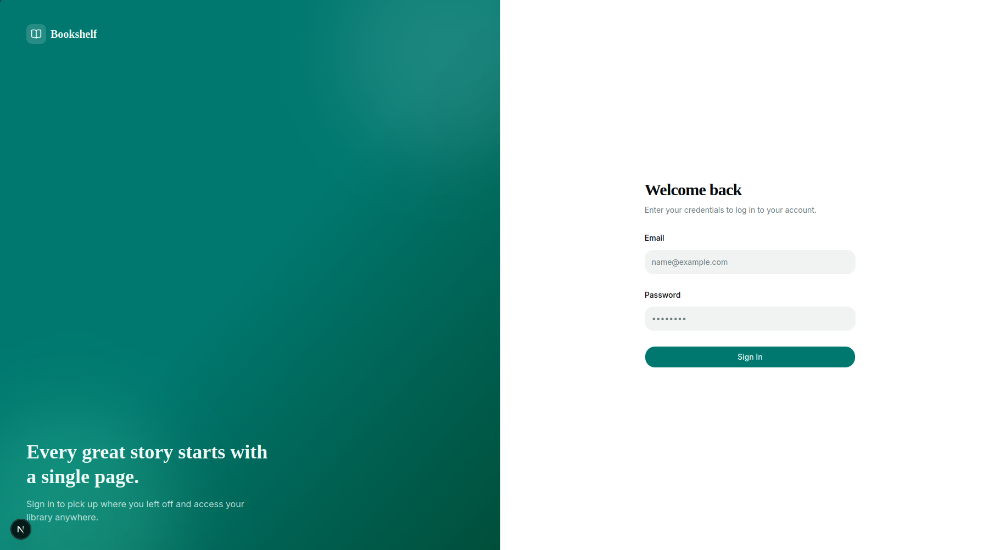
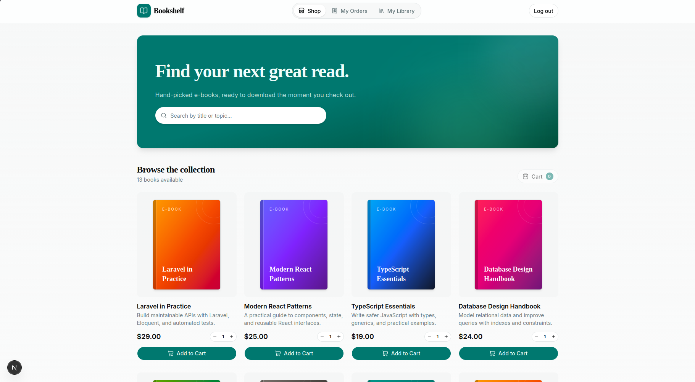
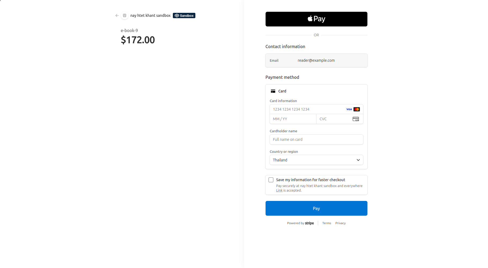
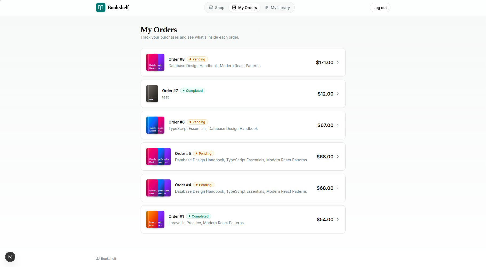
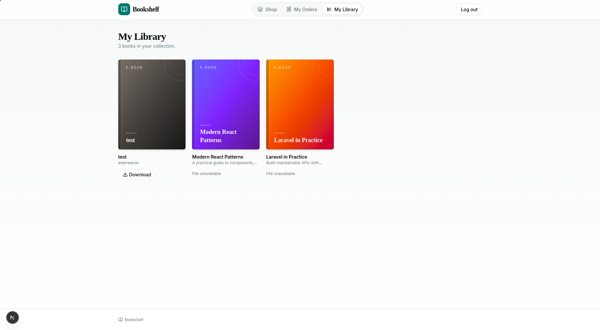
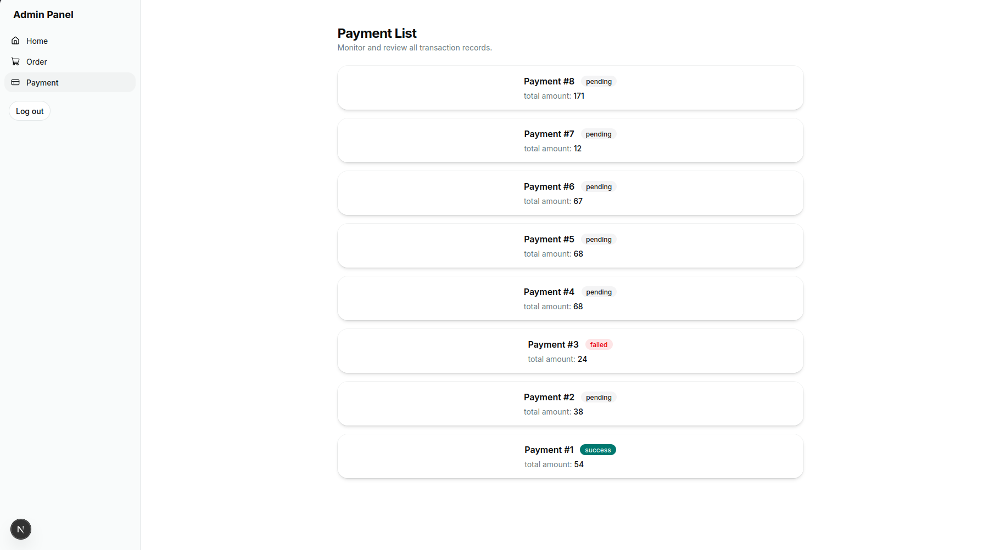
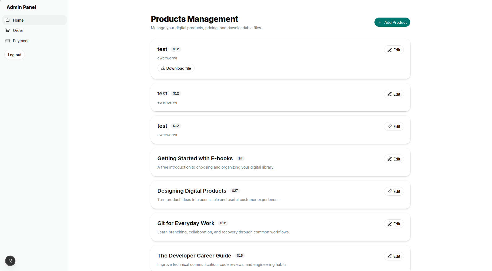
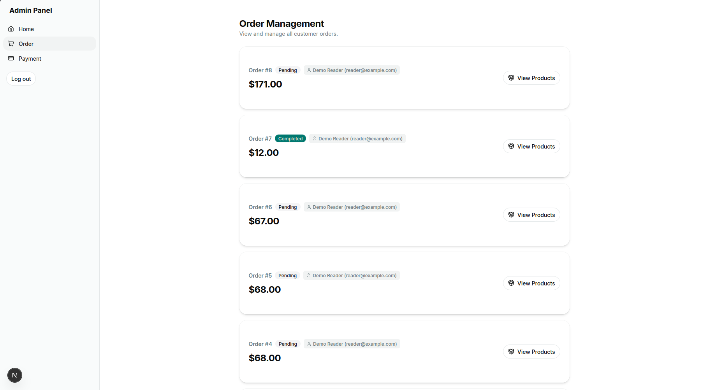

# E-Book Web — Digital Product Storefront

A Next.js frontend for a digital commerce platform, with customer shopping, Stripe Checkout redirection, purchased-file downloads, and an administrator dashboard for managing products, orders, and payments.

Built as a full-stack portfolio project using **React, Next.js, TypeScript, Laravel, MySQL, Stripe, and AWS S3** across two repositories.

- **Frontend — this repository:** [e-book-web](https://github.com/nayhtetkhant/e-book-web)
- **Backend API:** [e-book-api](https://github.com/nayhtetkhant/e-book-api)

## Screenshots

Screenshots from the development application, showing customer and administrator workflows.

### Customer Login

Bookshelf sign-in page.



### Digital Product Storefront

Browse the e-book collection, select quantities, and add products to the cart.



### Stripe Checkout

Complete the purchase through Stripe Checkout.



### Customer Orders

View purchase history, order totals, and pending or completed statuses.



### Customer Library

Access purchased titles and download available files; titles without an attached file show an unavailable state.



### Payment Management

Review payment records, amounts, and transaction statuses.



### Product Management

Create and edit digital products, manage prices, and access attached files.



### Order Management

Review customer orders, totals, statuses, and associated products.



## Features

### Customer Dashboard

- Separate customer login with API authentication.
- Browse digital products and select quantities.
- Review an order summary before checkout.
- Create orders through the Laravel API and redirect to Stripe Checkout.
- View order history and order details.
- Access a purchased-product library and request temporary download links.
- Loading skeletons, empty states, and download progress feedback.

### Administrator Dashboard

- Separate administrator login and dashboard layout.
- Create products with titles, descriptions, prices, and attached files.
- Upload files directly from the browser to S3 using an API-generated pre-signed PUT URL.
- Edit product details.
- View orders, order details, and payment records.

### Frontend Architecture

- Next.js App Router with customer and administrator route groups.
- Server actions for authentication and API operations.
- Axios API client that forwards the authentication token as a bearer token.
- HTTP-only cookies for authentication token and role storage.
- Reusable UI components, Tailwind styling, and mobile sidebar support.
- React Hook Form for product forms.

## Tech Stack

| Area | Technology |
| --- | --- |
| Framework | Next.js 16, React 19 |
| Language | TypeScript |
| Styling | Tailwind CSS 4 |
| Components | shadcn/Base UI, Lucide icons |
| Forms | React Hook Form |
| API client | Axios, Next.js server actions |
| Companion backend | Laravel 13, Laravel Sanctum |
| Database | MySQL in the backend example configuration |
| Payments | Stripe Checkout through Laravel Cashier |
| Asset storage | AWS S3 with pre-signed upload and download URLs |

## How the Platform Works

### Purchase Flow

1. The customer logs in and selects products.
2. The frontend submits product IDs and quantities to the API.
3. The backend calculates prices from database records and creates an order and pending payment.
4. The frontend redirects the customer to the Checkout URL returned by the API.
5. The backend webhook listener processes paid Stripe Checkout events and associates purchased products with the customer.
6. The customer opens **My Downloads** and requests a download link for a product.

### Asset Upload and Download

The administrator creates a product and requests a temporary upload URL from the backend. The browser uploads the selected file directly to S3, keeping file transfer separate from the API request.

For downloads, the frontend requests a URL on demand. The companion backend currently generates S3 download URLs with a **10-minute expiration**.

> Current limitation: the backend download endpoint requires authentication but does not yet verify that the requesting user purchased the product. Purchase authorization must be enforced on the server before this can serve as a protected production download platform. Displaying only purchased products in the UI does not enforce API authorization.

## Getting Started

### Prerequisites

- Node.js compatible with the Next.js version in `package.json`.
- npm.
- The companion Laravel API running at `http://localhost:8000`.
- Stripe test credentials and configured S3 storage in the backend for checkout and file operations.

### Installation

```bash
git clone https://github.com/nayhtetkhant/e-book-web.git
cd e-book-web
npm ci
npm run dev
```

Open [http://localhost:3000](http://localhost:3000).

### API Configuration

The API base URL is currently set in `app/libs/api.ts`:

```ts
baseURL: "http://localhost:8000/api"
```

Change it to match your API deployment. Environment-based configuration is a planned improvement; adding an environment variable alone will not change the current client.

Set up the [Laravel backend](https://github.com/nayhtetkhant/e-book-api) separately, including database migrations, development users, Stripe webhook delivery, and S3 credentials. Configure S3 CORS to allow the frontend origin to upload using PUT requests.

The backend currently maps upload MIME types for JPEG, PNG, WebP, and GIF. Although the frontend file field allows selecting other files, PDF/e-book uploads require extending backend validation and MIME support.

### Main Routes

| Route | Purpose |
| --- | --- |
| `/user/login` | Customer login |
| `/user/dashboard` | Product browsing and order selection |
| `/user/dashboard/order` | Customer order history |
| `/user/dashboard/download` | Purchased-product downloads |
| `/admin/login` | Administrator login |
| `/admin/dashboard` | Product management |
| `/admin/dashboard/order` | Order management |
| `/admin/dashboard/payment` | Payment records |

### Available Commands

```bash
npm run dev     # Start the development server
npm run build   # Create a production build
npm run start   # Serve the production build
npm run lint    # Run ESLint
```

## Project Structure

```text
app/
├── (app)/
│   ├── admin/          # Administrator login and dashboard pages
│   └── user/           # Customer login, storefront, orders, and downloads
├── actions/
│   ├── admin/          # Administrator authentication and payment actions
│   ├── shared/         # Product and order API actions
│   └── user/           # Customer authentication actions
├── libs/api.ts         # Axios client and authentication forwarding
├── globals.css
└── layout.tsx
components/ui/          # Shared interface components
hooks/                  # Shared hooks, including mobile detection
lib/                    # Utility functions
```

## Digital Asset Security Design

For a production implementation, I would keep original files private and make the backend responsible for every download authorization decision:

1. Authenticate the user.
2. Verify a paid, active purchase entitlement for the requested product.
3. Issue a short-lived S3 pre-signed GET URL only after that check succeeds.
4. Grant entitlements through verified Stripe webhooks rather than the browser's success redirect.
5. Make payment processing retry-safe, validate payment amount and currency, and define refund and entitlement-revocation behavior.
6. Add download rate limits and audit logs; keep storage credentials exclusively on the server.

A signed URL can be shared while valid, so expiration reduces exposure but does not prevent redistribution of downloaded files. Watermarked previews and licensing would complement access control.

## Recommended Stack for Extending the Platform

**Next.js + TypeScript, Laravel + Sanctum, MySQL, Stripe, and private AWS S3 storage** would build directly on this project:

- **Next.js and React:** reusable storefront, checkout, library, and administrator interfaces.
- **Laravel:** structured validation, authorization, payment integration, storage access, and background-job support.
- **MySQL:** relational records for products, orders, payments, purchase entitlements, and future licenses.
- **Stripe Checkout:** hosted payment collection with server-side webhook fulfillment.
- **Private S3 storage:** direct uploads and time-limited downloads without permanent public links.

Cloudflare R2 is an alternative to evaluate for S3-compatible storage. CDN delivery should distinguish public previews from private purchased originals. Neither R2 nor a CDN deployment is demonstrated by this repository.

## Roadmap

- Complete server-side purchase and role authorization.
- Add PDF/e-book upload validation and reliable upload completion handling.
- Add license generation and license management.
- Add watermarked preview assets and dedicated 2D/3D viewers.
- Add PayPal as an optional payment provider.
- Move API and checkout redirect URLs into environment configuration.
- Improve user-facing errors and test checkout, payment failure, and download authorization flows.
- Verify responsive layouts, keyboard accessibility, and production deployment behavior.

## Project Status

This is a development portfolio project. It demonstrates frontend integration with digital commerce and file-delivery workflows; licensing, watermarking, 3D viewers, and PayPal are planned extensions.
